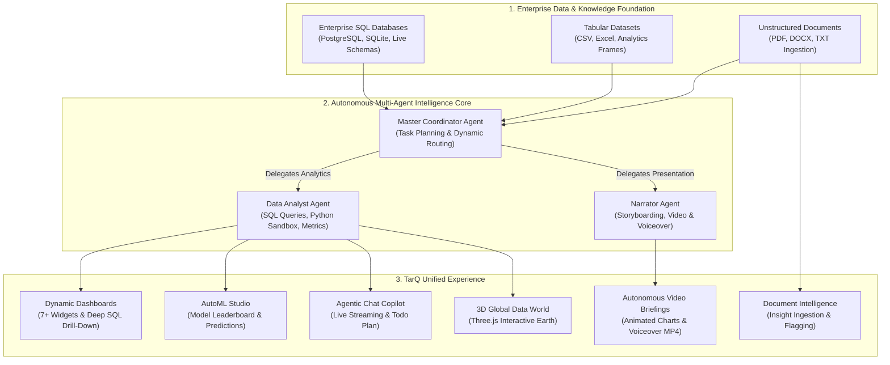

# TarQ Platform — Functional Specification & User Guide

**Document Version:** 1.0.0  
**Target Audience:** Product Managers, Business Analysts, Data Scientists, Executive Stakeholders, and Platform End-Users  
**Related Documents:** [Root README](../../README.md) | [Technical Specification](../technical/technical_specification.md)

---

## 1. Executive Summary & Product Vision

**TarQ** is an enterprise-grade **Agentic Dashboard and Data Intelligence Platform**. It bridges the gap between raw enterprise data and decision-making by unifying conversational multi-agent AI, ad-hoc SQL querying, automated machine learning (AutoML), dynamic interactive dashboards, and programmatic motion video generation into a single cohesive interface.

Traditional Business Intelligence (BI) platforms require manual schema modeling, complex query writing, static dashboard maintenance, and separate presentation tools. TarQ automates this entire lifecycle:
1. **Understands Intent:** Users express analytical queries in natural language.
2. **Plans & Orchestrates:** An autonomous Master Coordinator decomposes complex analytical requests into discrete tasks.
3. **Retrieves & Computes:** Specialized agents query authorized enterprise databases, execute Python code in an isolated execution sandbox, and calculate auditable metrics.
4. **Visualizes & Synthesizes:** TarQ generates real-time, drill-down interactive dashboards and renders narrated motion video presentations with synchronized voiceover.



### The Three Functional Tiers of TarQ

1. **Enterprise Data & Knowledge Foundation:**
   * **Enterprise Relational Databases:** Direct connectivity to remote PostgreSQL and SQLite instances with automated schema discovery, granular table allowlisting, and zero-trust credential encryption.
   * **Tabular Datasets:** Uploads of structured operational files (CSV, TSV, Excel) loaded directly into the analyst computing sandbox.
   * **Unstructured Documents:** Ingestion of enterprise reports, contracts, and research documents (PDF, DOCX, TXT) with automatic chunking and knowledge extraction.

2. **Autonomous Multi-Agent Intelligence Core:**
   * **Master Coordinator:** Evaluates analytical goals, orchestrates multi-turn plans, tracks live execution states, and delegates work.
   * **Data Analyst:** Executes auditable SQL queries, writes and runs pandas data manipulation code in an isolated execution sandbox, and generates data-driven visualization specs.
   * **Narrator:** Transforms verified data artifacts into animated motion videos with synchronized natural-sounding voiceover narration.

3. **TarQ Unified User Experience:**
   * Delivers seamless interaction across six functional modes: conversational chat with a live Todo plan, dynamic dashboards with deep SQL drill-down, an AutoML training and prediction studio, document intelligence with confidence flagging, autonomous video briefings, and an interactive 3D global data explorer.

---

## 2. User Personas & Target Audiences

| Persona | Primary Goal | How TarQ Serves Them | Key Functional Features Used |
| :--- | :--- | :--- | :--- |
| **Executive / Leadership** | Quick strategic clarity, KPI visibility, and high-impact briefings. | Receives automated executive summaries, KPI stat cards, and AI-generated motion videos with voiceover for board presentations. | Narrator Agent, Video Briefing, KPI Stat Widgets, PDF Dashboard Reports. |
| **Business / Data Analyst** | Rapid ad-hoc data exploration, correlation analysis, and dashboard publishing. | Converses with the Data Analyst agent to query databases, visualize distributions, and build live multi-chart dashboards in seconds. | Agentic Chat, Dashboard Builder, SQL Drilldowns, GIS Geospatial Mapping. |
| **ML Practitioner / Data Scientist** | Rapid baseline model creation, feature importance discovery, and inference prototyping. | Trains supervised models automatically without writing boilerplate code, analyzes Optuna hyperparameter trials, and tests predictions interactively. | AutoML Studio, Optuna Leaderboard, Feature Importance, Inference Console. |
| **Operations & Risk Officer** | Auditable data exploration, system monitoring, and compliance assurance. | Monitors agent execution plans, verifies query definitions, and audits data origins with strict read-only guarantees. | Live Todo Plan, Schema Explorer, Execution Logs, Sandbox Isolation. |

---

## 3. Core Functional Capabilities

### 3.1 Conversational Agentic Copilot & Dynamic Task Planning
Users interact with TarQ through a natural language copilot backed by an autonomous multi-agent fleet:
* **Master Coordinator:** Evaluates incoming user prompts, evaluates existing progress, and constructs a transparent, prioritized **Todo Task Plan** consisting of tasks assigned to specialized workers (`Data Analyst` or `Narrator`).
* **Live Task Visibility:** The UI dynamically renders the current task list in real time, displaying task statuses:
  * `pending`: Scheduled for execution.
  * `in_progress`: Currently being executed by the assigned agent.
  * `completed`: Deliverable verified and produced.
  * `blocked`: Blocked by missing inputs, unavailable permissions, or ambiguities.
* **Streaming Responses:** Agent thoughts, tool executions, and findings stream to the chat window in real time via WebSocket.
* **Transparent Reasoning & Notes:** The Coordinator publishes concise operational notes explaining routing decisions and blockers.

### 3.2 Multi-Source Data Connectivity & Schema Explorer
TarQ provides an integrated Data Source manager for connecting enterprise databases:
* **Supported Source Types:** Remote PostgreSQL databases and local SQLite instances.
* **Live Schema Introspection:** Automatically inspects database connections to enumerate available tables, column definitions, data types, and primary/foreign keys.
* **Granular Table Allowlisting:** Users explicitly select which tables are accessible to agents for each session. Agents are strictly restricted to the allowlisted tables.
* **Secure Credential Isolation:** Passwords and credentials are encrypted at rest using industrial-strength cryptography and are never exposed to LLM contexts, prompts, or client-side responses.
* **Health & Connection Diagnostics:** Immediate connection validation and status badges (`connected`, `ready`, `error`).

### 3.3 Dynamic Agentic Dashboards & Rich Data Visualization
The platform features an automated, data-driven dashboard engine capable of rendering multi-widget analytical views from JSON contracts (`DashboardSpec`):
* **Widget Type Catalog:**
  1. **Bar & Stacked Bar Charts:** Categorical comparisons, revenue breakdowns, and multi-series distributions.
  2. **Line & Multi-Line Charts:** Historical trends, time-series metrics, and multi-entity comparisons.
  3. **Area Charts:** Volume analysis, cumulative metrics, and portfolio growth.
  4. **Pie & Donut Charts:** Composition breakdowns, market share, and resource allocation.
  5. **Tables:** Tabular row-level data with sorting, pagination, and formatted numeric columns.
  6. **Stat KPI Cards:** High-level metrics, growth deltas, and performance targets.
  7. **GIS Geospatial Maps:** Interactive Leaflet maps rendering location-specific coordinates, points of interest, and weighted intensity heatmaps.
* **Interactive Drill-Downs:**
  * Clicking on any data point, bar, or table row triggers an instant contextual drill-down.
  * The system parameterizes the query and retrieves a deeper, child dataset (e.g., clicking on a business unit reveals individual transaction logs) in an interactive modal.
* **Live SQL Data Refresh:** Widgets backed by registered database connections can execute on-demand queries to refresh their contents with the latest production records.
* **PDF Report Generation:** One-click export that formats the dashboard layout, KPI stats, charts, and table summaries into a presentation-ready executive PDF document.

### 3.4 Automated Machine Learning (AutoML) Studio
TarQ includes an end-to-end, deterministic AutoML studio accessible via conversation or the dedicated ML interface:
* **Automatic Problem Framing:** Inspects tabular datasets to determine target variable cardinality and automatically infers whether the problem is **Classification** (binary or multiclass) or **Regression**.
* **Automated Preprocessing:** Handles missing values, imputes numerical features, scales continuous variables, and one-hot encodes categorical columns using standardized pipelines.
* **Optuna Hyperparameter Optimization:** Executes Bayesian optimization search trials across diverse model families (Logistic Regression, Ridge, Random Forest, Gradient Boosting).
* **Interactive Leaderboard:** Displays trial outcomes, validation scores (F1, Accuracy, RMSE, R²), hyperparameter configurations, and elapsed training durations.
* **Feature Importance Analysis:** Visualizes key predictive drivers, allowing analysts to understand what features influence model decisions.
* **Interactive Inference Console:** Users can input custom feature values directly in the browser to receive instant, real-time predictions from the trained model.
* **Natural Language Explanation:** An integrated explainability engine generates an executive textual summary detailing model performance, trade-offs, and deployment readiness.

### 3.5 Autonomous Motion Video & Voiceover Presentation (Narrator)
When executive briefings or dynamic presentations are required, the **Narrator Agent** transforms raw analytics into animated video presentations:
* **Programmatic Motion Graphics:** Leverages the Remotion engine to animate data charts, KPI reveals, and visual scenes using pure code.
* **Text-to-Speech (TTS) Voiceover:** Generates professional, natural voiceover narration corresponding to verified analytical facts.
* **Dynamic Frame Synchronization:** Automatically derives scene lengths and video frame counts based on the exact audio duration of the voiceover track.
* **Exportable MP4 Artifacts:** Compiles full 1080p MP4 videos that can be previewed directly within the platform or downloaded for executive presentations.

### 3.6 Unstructured Document Intelligence & Knowledge Ingestion
TarQ enables users to upload unstructured and semi-structured documents (PDF, DOCX, TXT):
* **Format-Agnostic Ingestion:** Chunks raw text streams and processes documents regardless of internal layout.
* **Information Extraction:** Extracts key numerical statistics, business metrics, trends, and executive summaries.
* **Confidence Guardrails:** If a document lacks sufficient structure or extraction runs without deep LLM validation, TarQ flags results as `low_confidence: true`, alerting users that manual verification is recommended.
* **Context Vault Storage:** Processed insights are cataloged as persistent artifacts, ensuring they remain accessible across subsequent analytical queries without bloating LLM context budgets.

### 3.7 3D Global Data World
The platform features an interactive 3D WebGL Earth globe rendered with Three.js:
* **Global Hub Exploration:** Visualizes global data hubs, operations centers, and cross-border data nodes.
* **Interactive Raycasting & Decals:** Hovering or clicking on coordinates displays holographic info cards and coordinate markers.
* **Dynamic Visual Backdrop:** Bridges spatial orientation with analytical data points for global organizations.

---

## 4. End-to-End User Journeys & Scenarios

### Scenario 1: Natural Language Inquiry to Live Dashboard
```
[User Prompt]
"Show me our top 5 revenue-generating sectors in FY24 from the financials database and build a dashboard."
       │
       ▼
[Master Coordinator]
- Inspects user request and attached 'financials' SQL database.
- Generates 2-step task plan:
  1. Data Analyst: Query sector revenues & build Bar + KPI widgets (in_progress).
  2. Data Analyst: Assemble into 'FY24 Revenue Performance' Dashboard (pending).
       │
       ▼
[Data Analyst Agent]
- Examines schema tables for 'financials'.
- Issues read-only SQL: `SELECT sector, SUM(revenue) FROM transactions WHERE fiscal_year=2024 GROUP BY sector ORDER BY 2 DESC LIMIT 5;`
- Synthesizes `WidgetSpec` for Bar Chart and Stat KPI Card.
- Calls `dashboard_tool` with `standalone=False` to publish the dashboard.
       │
       ▼
[Frontend UI]
- Real-time chat displays completed query and data summary.
- The Dashboard tab updates with the newly created dashboard.
- User clicks a specific sector bar to trigger a drill-down showing granular customer transactions.
```

### Scenario 2: End-to-End AutoML from CSV to Live Prediction
```
[User Action]
User uploads `customer_churn.csv` to the ML Training Studio, selects target column `churned`, and clicks "Train Model".
       │
       ▼
[ML Service Pipeline]
1. Ingests CSV into workspace.
2. Evaluates target distribution: Detects binary classification.
3. Automatically sets up preprocessing (imputation, scaling, one-hot encoding).
4. Launches Optuna study across Logistic Regression, Random Forest, and Gradient Boosting.
5. Evaluates 20 hyperparameter trials using 5-fold cross-validation.
6. Selects Gradient Boosting as best model (ROC-AUC = 0.912).
7. Serializes pipeline to model registry via joblib.
       │
       ▼
[Frontend UI]
- Displays training leaderboard with validation scores for all 20 trials.
- Visualizes Feature Importance bar chart (identifying `tenure` and `monthly_charges` as primary churn drivers).
- Opens Interactive Prediction Sandbox: User types sample customer parameters and clicks "Predict" to receive immediate churn probability.
```

### Scenario 3: Executive Motion Video Briefing Generation
```
[User Prompt]
"Create an animated video briefing analyzing our reliance vs adani revenue growth."
       │
       ▼
[Master Coordinator]
- Analyzes existing data artifacts and routes task to 'Narrator' agent.
       │
       ▼
[Narrator Agent]
- Reads verified financial data artifacts from the analyst sandbox.
- Writes a factual, verified narration script.
- Invokes TTS engine to synthesize audio voiceover.
- Queries audio duration to compute composition frame count at 30 fps.
- Generates Remotion React video composition mapping data points to animated motion charts.
- Executes headless Remotion rendering to build `corporate_analysis_summary.mp4`.
       │
       ▼
[Frontend UI]
- Chat streams completion status with a clickable video player card.
- User plays the animated video with synchronized narration and downloads the MP4.
```

---

## 5. Enterprise Guardrails, Compliance & Auditing

1. **Read-Only Database Enforcement:** All automated SQL queries are executed strictly within PostgreSQL read-only transactions with enforced 15-second statement timeouts, preventing data modification or long-running database locks.
2. **Deterministic Computation:** Analytical metrics and statistics are never estimated or hallucinated by LLMs. All numbers are computed deterministically via SQL or Python pandas scripts within an isolated execution sandbox.
3. **Low-Confidence Warnings:** Unstructured extractions that fall back to heuristic parsers are stamped with explicit low-confidence alerts, preventing unverified data from influencing critical decisions.
4. **Data Isolation & Sandboxing:** Multi-tenant workspace paths segregate file uploads, model artifacts, and sandbox worker processes.
5. **Human-in-the-Loop Oversight:** The live Todo plan permits users to inspect agent intent prior to execution, review blocked tasks, and provide clarifying instructions at any point.
